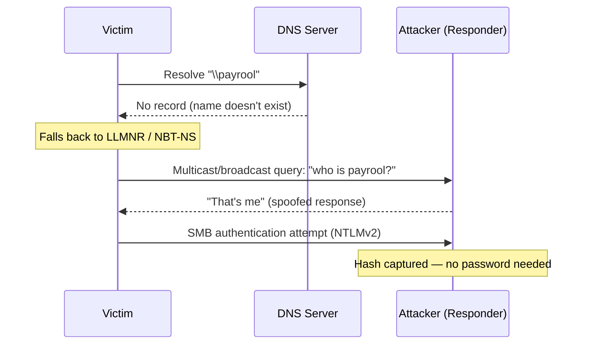

# LLMNR / NBT-NS Poisoning

How Windows name-resolution fallback protocols (LLMNR and NBT-NS) can be
abused on a local network to capture credentials — and why the design makes
it possible.

---

## Background: How Windows Resolves a Name

When a Windows client resolves a name, it works through the following order.
The last two steps — LLMNR and NBT-NS — are the fallback protocols that make
this attack possible.

| Order | Step | What happens |
|-------|------|--------------|
| 1 | **Local DNS cache** | The client first looks for the name (e.g. `www.hackeru.com`) in its own DNS cache. |
| 2 | **Root DNS query** | If the cache has no record, the configured DNS server queries the root servers for the `.com` TLD servers. |
| 3 | **TLD DNS query** | The DNS server then queries the `.com` servers for the authoritative name server of `hackeru.com`, and that server for the host's IP. |
| 4 | **LLMNR** | If DNS can't resolve the name, the client checks its LLMNR cache, then sends a **multicast** query across the local subnet. |
| 5 | **NBT-NS** | If LLMNR also fails, the client falls back to NetBIOS Name Service, **broadcasting** a request for the host's NetBIOS name. |

Steps 4 and 5 are the weak point: both ask *the whole local network* "who is
this?" and trust whoever answers first.

---

## The Protocols

### NBT-NS

NetBIOS Name Service (NBT-NS) predates LLMNR and resolves names when DNS
fails. A computer broadcasts a query across the local network asking which
host owns a given NetBIOS name. An attacker can respond to that broadcast and
impersonate the requested name, tricking the victim into connecting to the
attacker's machine instead.

### LLMNR

Link-Local Multicast Name Resolution (LLMNR) is the successor to NBT-NS,
serving the same fallback role — resolving a name locally via multicast when
DNS fails. Like NBT-NS, its mechanism lets an attacker on the same network
segment answer the multicast query, impersonate the target host, and capture
credentials or redirect traffic.

---

## How LLMNR Poisoning Works

LLMNR poisoning (also called LLMNR/NBT-NS spoofing) abuses the fact that these
fallback protocols trust *any* response on the local network — there is no
authentication, and the first reply wins.

| Step | What happens |
|------|--------------|
| 1. Trigger | A client tries to resolve a name and DNS fails (mistyped hostname, a share that no longer exists, an auto-lookup, etc.). Windows falls back to LLMNR, then NBT-NS, broadcasting the request to the local subnet. |
| 2. Attacker responds | An attacker on the same segment (e.g. using **Responder**) listens for these queries. Because nothing verifies who may answer, the attacker replies "that's me" — claiming to be whatever name the victim was looking for. |
| 3. Victim connects | The victim's machine trusts the spoofed response and tries to authenticate to the attacker's machine, commonly over SMB. |
| 4. Credential capture | During authentication the victim sends an **NTLMv2 hash** (challenge/response), which the attacker captures. |

The captured hash can then be:

- **Cracked offline** with hashcat or John the Ripper to recover the plaintext
  password (see the [Lab Walkthrough](./lab-walkthrough.md)), or
- **Relayed in real time** to another machine (NTLM relay via `ntlmrelayx`) to
  authenticate as the victim elsewhere — which can lead to code execution if
  relayed to a host where that user has admin rights (see
  [SMB Relay Attack](./smb-relay-attack.md)).

**Why it works:** LLMNR and NBT-NS have no authentication for who is allowed
to answer a name query — a trust-everyone-on-the-LAN design, which is exactly
what makes them exploitable.

> For the difference between the captured Net-NTLMv2 *response* and the NT hash
> at rest, see [Windows Password Hashes](./windows_hashes_notes.md).

---

## Mitigations

- Disable LLMNR via Group Policy
  (`Computer Configuration → Administrative Templates → Network → DNS Client →
  Turn off multicast name resolution`).
- Disable NBT-NS on each adapter (or via DHCP option 001 / a startup script).
- Enforce **SMB signing** to block NTLM relay.
- Use long, strong passwords so captured NTLMv2 hashes are impractical to
  crack.

---

## Related Notes

- [Lab Walkthrough](./lab-walkthrough.md) — this attack captured end-to-end
  with screenshots, from poisoning to cracked password.
- [Windows Password Hashes](./windows_hashes_notes.md) — what the captured
  hash actually is, and how it differs from the NT hash at rest.
- [SMB Relay Attack](./smb-relay-attack.md) — using the captured
  authentication live instead of cracking it.

---

> **For authorized testing only.** These techniques are documented for
> learning and for use in labs or engagements you have explicit permission to
> test.
