  

# Active Directory Attacks

Notes I kept while building a small Windows Server 2022 + Kali lab and working
through the common Active Directory attack paths. For each one I wanted to
understand how it actually works, what it looks like when you run it, and what
stops it, rather than just copy-pasting commands. Every attack here was run end
to end against VMs I own, and the walkthroughs use screenshots from the real
runs.

Tools I leaned on: Responder, Impacket, NetExec, Hashcat, Wireshark, nmap,
Kerbrute.

## Contents

- [LLMNR / NBT-NS Poisoning](./LLMNR-NBT-NS-Poisoning.md) — capturing credentials
  off the Windows name-resolution fallback on a local network
- [Lab Walkthrough](./lab-walkthrough.md) — that poisoning attack start to
  finish, from the broadcast to a cracked password
- [Windows Password Hashes](./windows_hashes_notes.md) — LM vs NT, where they
  live, and the Net-NTLM protocols (v1 / v2 / SSP)
- [SMB Relay](./smb-relay-attack.md) — relaying the captured auth to another host
  instead of cracking it
- [AD Enumeration with NetExec](./ad-enumeration.md) — one credential to users,
  shares, groups, policy, and an NTDS dump
- [Password Spraying](./password-spraying.md) — one password against every
  account without tripping lockout ([lab run](./password-spraying-lab-walkthrough.md))

---

## How it chains together

None of these stand alone. The whole thing starts with a single mistyped
hostname and ends on the domain controller:

```mermaid
flowchart LR
    A["DNS lookup fails"] --> B["LLMNR / NBT-NS broadcast"]
    B --> C["Responder answers as the victim"]
    C --> D["Victim authenticates to attacker"]
    D --> E["NTLMv2 hash captured"]
    E --> F{"Crackable?"}
    F -->|yes| G["Crack offline (hashcat)"]
    F -->|no| H["Relay live (ntlmrelayx)"]
    G --> J["Valid credential"]
    H --> I["Session as the victim"]
    J --> K["Enumerate the domain (NetExec)"]
    I --> K
    K --> L["Spray reused passwords"]
    L --> M["Domain compromise / NTDS dump"]

    style A fill:#161b22,stroke:#30363d,color:#e6edf3
    style B fill:#161b22,stroke:#30363d,color:#e6edf3
    style C fill:#161b22,stroke:#f85149,color:#e6edf3
    style D fill:#161b22,stroke:#30363d,color:#e6edf3
    style E fill:#161b22,stroke:#d29922,color:#e6edf3
    style F fill:#161b22,stroke:#30363d,color:#e6edf3
    style G fill:#161b22,stroke:#39d353,color:#e6edf3
    style H fill:#161b22,stroke:#58a6ff,color:#e6edf3
    style I fill:#161b22,stroke:#58a6ff,color:#e6edf3
    style J fill:#161b22,stroke:#39d353,color:#e6edf3
    style K fill:#161b22,stroke:#bc8cff,color:#e6edf3
    style L fill:#161b22,stroke:#bc8cff,color:#e6edf3
    style M fill:#161b22,stroke:#f85149,color:#e6edf3
```

If you're reading through, this order makes the most sense: poisoning → lab
walkthrough → password hashes → SMB relay → enumeration → spraying.

---

## ATT&CK reference

I mapped each technique back to MITRE ATT&CK while taking the notes, mostly to
keep my own coverage honest:

| ID | Technique | Where |
|----|-----------|-------|
| [T1557.001](https://attack.mitre.org/techniques/T1557/001/) | LLMNR/NBT-NS poisoning & SMB relay | [poisoning](./LLMNR-NBT-NS-Poisoning.md), [relay](./smb-relay-attack.md) |
| [T1110.002](https://attack.mitre.org/techniques/T1110/002/) | Password cracking | [lab walkthrough](./lab-walkthrough.md) |
| [T1110.003](https://attack.mitre.org/techniques/T1110/003/) | Password spraying | [spraying](./password-spraying.md) |
| [T1003.002 / .003](https://attack.mitre.org/techniques/T1003/) | Credential dumping (SAM / NTDS) | [enumeration](./ad-enumeration.md) |
| [T1087.002](https://attack.mitre.org/techniques/T1087/002/) | Domain account discovery | [enumeration](./ad-enumeration.md) |
| [T1069.002](https://attack.mitre.org/techniques/T1069/002/) | Domain group discovery | [enumeration](./ad-enumeration.md) |

---

## Defending against this

A small set of controls breaks most of the chain above:

- Turn off LLMNR and NBT-NS so the poisoning has nothing to answer.
- Enforce SMB signing, which kills the relay outright.
- Require long passphrases so a captured hash isn't worth cracking.
- Add MFA and smart lockout to take the sting out of spraying.
- Prefer Kerberos over NTLM, and keep local admin rights scoped (LAPS).

Each page has its own mitigations section with the specifics.
