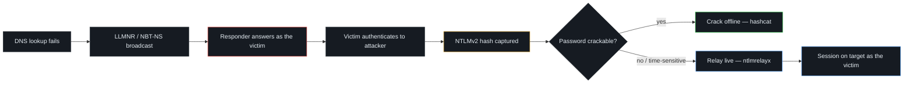

  

  
  
  

Study notes and reference material on common Active Directory attack
techniques — how they work, how they chain together, and how to defend
against them. Each topic pairs the underlying theory with a hands-on lab
capture.

---

## Contents

- **[LLMNR / NBT-NS Poisoning](./LLMNR-NBT-NS-Poisoning.md)** — abusing Windows
  name-resolution fallback protocols to capture credentials on a local
  network.
- **[Lab Walkthrough](./lab-walkthrough.md)** — the LLMNR/NBT-NS attack
  captured end-to-end with screenshots, from poisoning to cracked password.
- **[Windows Password Hashes](./windows_hashes_notes.md)** — LM vs NT hashes,
  where they're stored, and the Net-NTLM authentication protocols (v1 / v2 /
  SSP).
- **[SMB Relay Attack](./smb-relay-attack.md)** — relaying captured
  authentication to another host instead of cracking it, with Responder +
  ntlmrelayx.

---

## Attack Chain

Everything in this repo follows one chain, starting from a single mistyped
hostname:

| Stage | Covered in |
|---|---|
| Poison name resolution | [LLMNR / NBT-NS Poisoning](./LLMNR-NBT-NS-Poisoning.md) |
| Capture it end-to-end, with screenshots | [Lab Walkthrough](./lab-walkthrough.md) |
| Understand what was actually captured | [Windows Password Hashes](./windows_hashes_notes.md) |
| Use the capture without cracking it | [SMB Relay Attack](./smb-relay-attack.md) |

Suggested reading order: LLMNR/NBT-NS Poisoning → Lab Walkthrough → Windows
Password Hashes → SMB Relay Attack.

---

## Defensive Summary

The same handful of controls breaks most of this chain:

- Disable **LLMNR** and **NBT-NS** so the poisoning step has nothing to answer.
- Enforce **SMB signing** to block NTLM relay.
- Require **long, strong passwords** so captured hashes resist offline
  cracking.
- Prefer **Kerberos over NTLM**, and limit local admin rights (LAPS) to
  contain anything that does get through.

Each document's own *Mitigations* section covers its technique in more detail.
