  

  
  
  
  
  
  

  
  
  
  

  <b>Offensive Active Directory tradecraft, documented end-to-end.</b> 
  Each technique pairs the <i>why it works</i> with a screenshot-backed lab run —
  from a single mistyped hostname all the way to full domain compromise.

---

## 🎯 What this repo demonstrates

A complete, hands-on attack chain against a Windows Server 2022 Active Directory
lab — researched, executed, captured, and mapped to defenses:

- **Network-level credential theft** — LLMNR/NBT-NS poisoning with Responder,
  verified at the packet level in Wireshark.
- **Using credentials without cracking them** — live NTLM relay with Impacket.
- **Offline cracking** — NetNTLMv2 recovery with Hashcat and `rockyou`.
- **Authenticated enumeration** — users, shares, groups, and policy with NetExec.
- **Credential access at scale** — password spraying tuned to lockout policy, to
  a domain-admin hit.
- **Blue-team perspective** — every document ends with concrete mitigations.

> Built in an isolated home lab on VMs I own, as a self-study portfolio of
> AD attack paths and the controls that break them.

---

## 📂 Contents

| # | Technique | What it covers |
|---|-----------|----------------|
| 1 | **[LLMNR / NBT-NS Poisoning](./LLMNR-NBT-NS-Poisoning.md)** | Abusing Windows name-resolution fallback to capture credentials on a LAN. |
| 2 | **[Lab Walkthrough](./lab-walkthrough.md)** | The LLMNR/NBT-NS attack end-to-end with screenshots, poisoning → cracked password. |
| 3 | **[Windows Password Hashes](./windows_hashes_notes.md)** | LM vs NT hashes, where they live, and the Net-NTLM protocols (v1 / v2 / SSP). |
| 4 | **[SMB Relay Attack](./smb-relay-attack.md)** | Relaying captured auth to another host instead of cracking it (Responder + ntlmrelayx). |
| 5 | **[AD Enumeration with NetExec](./ad-enumeration.md)** | One credential → users, shares, groups, policy → NTDS dump & domain compromise. |
| 6 | **[Password Spraying](./password-spraying.md)** · **[Lab](./password-spraying-lab-walkthrough.md)** | One password vs. many accounts, kept under lockout thresholds, to a domain hit. |

---

## ⛓️ Attack Chain

Everything here follows one chain, starting from a single mistyped hostname:

```mermaid
flowchart LR
    A["DNS lookup fails"] --> B["LLMNR / NBT-NS broadcast"]
    B --> C["Responder answers as the victim"]
    C --> D["Victim authenticates to attacker"]
    D --> E["NTLMv2 hash captured"]
    E --> F{"Password crackable?"}
    F -->|yes| G["Crack offline — hashcat"]
    F -->|no / time-sensitive| H["Relay live — ntlmrelayx"]
    G --> J["Valid credential"]
    H --> I["Session on target as the victim"]
    J --> K["Enumerate domain — NetExec"]
    I --> K
    K --> L["Spray reused passwords"]
    L --> M["Domain compromise — NTDS dump"]

    style A fill:#161b22,stroke:#30363d,color:#e6edf3
    style B fill:#161b22,stroke:#30363d,color:#e6edf3
    style C fill:#161b22,stroke:#f85149,color:#e6edf3
    style D fill:#161b22,stroke:#30363d,color:#e6edf3
    style E fill:#161b22,stroke:#d29922,color:#e6edf3
    style F fill:#161b22,stroke:#30363d,color:#e6edf3
    style G fill:#161b22,stroke:#39d353,color:#e6edf3
    style H fill:#161b22,stroke:#58a6ff,color:#e6edf3
    style I fill:#161b22,stroke:#58a6ff,color:#e6edf3
    style J fill:#161b22,stroke:#39d353,color:#e6edf3
    style K fill:#161b22,stroke:#bc8cff,color:#e6edf3
    style L fill:#161b22,stroke:#bc8cff,color:#e6edf3
    style M fill:#161b22,stroke:#f85149,color:#e6edf3
```

**Suggested reading order:** LLMNR/NBT-NS Poisoning → Lab Walkthrough → Windows
Password Hashes → SMB Relay Attack → AD Enumeration → Password Spraying.

---

## 🗺️ MITRE ATT&CK Mapping

Each technique mapped to its ATT&CK ID, so the coverage is legible at a glance:

| ATT&CK ID | Technique | Documented in |
|-----------|-----------|---------------|
| [T1557.001](https://attack.mitre.org/techniques/T1557/001/) | LLMNR/NBT-NS Poisoning & SMB Relay | [Poisoning](./LLMNR-NBT-NS-Poisoning.md) · [SMB Relay](./smb-relay-attack.md) |
| [T1110.002](https://attack.mitre.org/techniques/T1110/002/) | Brute Force: Password Cracking | [Lab Walkthrough](./lab-walkthrough.md) |
| [T1110.003](https://attack.mitre.org/techniques/T1110/003/) | Brute Force: Password Spraying | [Password Spraying](./password-spraying.md) |
| [T1003.002 / .003](https://attack.mitre.org/techniques/T1003/) | OS Credential Dumping (SAM / NTDS) | [AD Enumeration](./ad-enumeration.md) |
| [T1087.002](https://attack.mitre.org/techniques/T1087/002/) | Account Discovery: Domain Account | [AD Enumeration](./ad-enumeration.md) |
| [T1069.002](https://attack.mitre.org/techniques/T1069/002/) | Permission Groups Discovery | [AD Enumeration](./ad-enumeration.md) |
| [T1021.002](https://attack.mitre.org/techniques/T1021/002/) | Remote Services: SMB / Admin Shares | [SMB Relay](./smb-relay-attack.md) |

---

## 🧰 Tooling

`Responder` · `Impacket (ntlmrelayx, secretsdump)` · `NetExec` · `Hashcat` ·
`Wireshark` · `nmap` · `Kerbrute` — run from Kali against a Windows Server 2022
domain controller.

---

## 🛡️ Defensive Summary

The same handful of controls breaks most of this chain:

- Disable **LLMNR** and **NBT-NS** so the poisoning step has nothing to answer.
- Enforce **SMB signing** to block NTLM relay.
- Require **long, strong passphrases** so captured hashes resist offline cracking.
- Add **MFA** and **smart lockout** to blunt password spraying.
- Prefer **Kerberos over NTLM**, and limit local admin rights (**LAPS**) to
  contain anything that does get through.

Each document's own *Mitigations* section covers its technique in detail.
