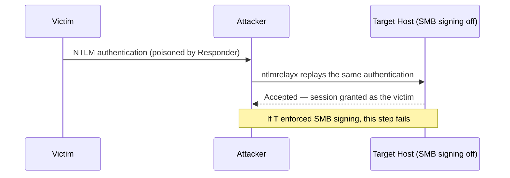

# SMB Relay Attack

Relaying captured NTLM authentication live to a second host instead of
cracking it offline — logging in *as* the victim without ever recovering
their password.

---

## Why Relay Instead of Crack

LLMNR/NBT-NS poisoning (see [LLMNR / NBT-NS Poisoning](./LLMNR-NBT-NS-Poisoning.md))
hands you a captured NTLMv2 challenge/response. Normally that gets cracked
offline with hashcat or John the Ripper — but cracking depends on the
password being weak enough, and a long random password can make that
impractical.

SMB relay sidesteps cracking entirely: instead of capturing the
authentication and walking away with it, the attacker sits in the middle and
**forwards it live**, in real time, to a different machine. The victim
authenticates once; the attacker's tooling replays that authentication
against the second target, which accepts it as legitimate — no password
ever recovered, none needed.

---

## How the Relay Works



| Step | What happens |
|------|--------------|
| 1. Poison | Responder answers an LLMNR/NBT-NS query as usual, so the victim is tricked into authenticating to the attacker's machine. |
| 2. Hand off | Responder does **not** grab the authentication itself. It's configured to leave SMB/HTTP free so a separate relay tool can catch it instead. |
| 3. Relay | `ntlmrelayx.py` (Impacket) receives the victim's NTLM authentication and immediately replays it against a chosen target host. |
| 4. Access | The target treats the relayed authentication as a normal login from the victim's account — granting the attacker a session as that user, with whatever privileges the account has there. |

**Why it works:** NTLM authentication isn't tied to a specific destination by
default — nothing stops a captured authentication attempt from being
forwarded somewhere else and replayed as-is. SMB signing is the control that
closes this gap (more on that below).

---

## Setting It Up

### 1. Reconfigure Responder to step aside

For a relay, Responder's only job is **name poisoning** — it must *not*
capture the authentication itself, or there's nothing left to relay. In
`/etc/responder/Responder.conf`:

```ini
SMB  = Off
HTTP = Off
```

Leave `LLMNR`, `NBTNS`, and `MDNS` on. This frees up the SMB/HTTP ports for
the relay tool to listen on instead.

### 2. Relay the captured authentication

```bash
ntlmrelayx.py -tf targets.txt -smb2support
```

| Flag | What it does |
|---|---|
| `-tf targets.txt` | Target **file** — a list of hosts to relay to, one per line. Use `-t <host>` to relay to a single target instead. |
| `-smb2support` | Enables SMB2/3 support, so the relay works against modern Windows (SMB1 is disabled by default on current systems). |

---

## Finding Relay Targets

Before building a target list, sweep the subnet for live hosts:

```bash
nmap -sn 192.168.0.0/24
```

| Flag | What it does |
|---|---|
| `-sn` | Host-discovery only (ping scan) — no port scan, just finds which IPs are up. |
| `192.168.0.0/24` | The subnet range to sweep (all 256 addresses). Confirm the real subnet with `ip a` first. |

From the live hosts, the goal is to find machines **without SMB signing
enforced** — those are the only viable relay targets (see below).

---

## Requirements & Limitations

1. **SMB signing must be disabled on the target.** Signing cryptographically
   ties each SMB message to its session; a relayed authentication fails that
   check immediately. This is *the* control that defeats this attack —
   everything else is secondary.
2. **The relayed account needs local admin on the target.** Relaying a
   low-privilege user just produces a low-privilege session. Admin is what
   turns the relay into something useful: dumping SAM, `psexec`-style command
   execution, or pulling credentials from LSASS.
3. **The source and target of a relay must be different hosts.** Relaying
   credentials back to the machine they came from is NTLM reflection, patched
   by MS08-068 — it no longer works against patched systems.
4. **Each captured authentication is generally one-shot.** Once it's relayed
   and used (or it expires), that authentication is spent. A fresh relay
   needs a fresh capture, unless it's being relayed to multiple targets
   simultaneously in the same window.

---

## Mitigations

- **Enforce SMB signing** (`required`/`always`) — this alone breaks the
  relay and is the real fix, not just general hardening.
- Disable NTLM in favor of Kerberos where possible.
- Disable LLMNR / NBT-NS so the poisoning step that feeds the relay never
  happens in the first place.
- Restrict local admin rights and enforce unique local admin passwords
  (LAPS) to limit how far a successful relay can reach.

---

> **For authorized testing only.** These techniques are documented for
> learning and for use in labs or engagements you have explicit permission
> to test.
